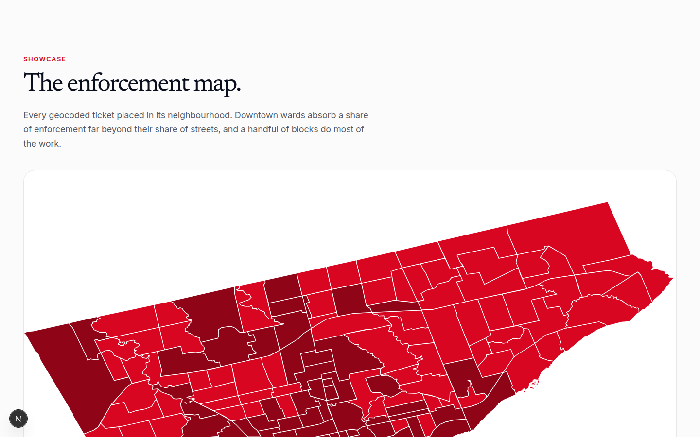
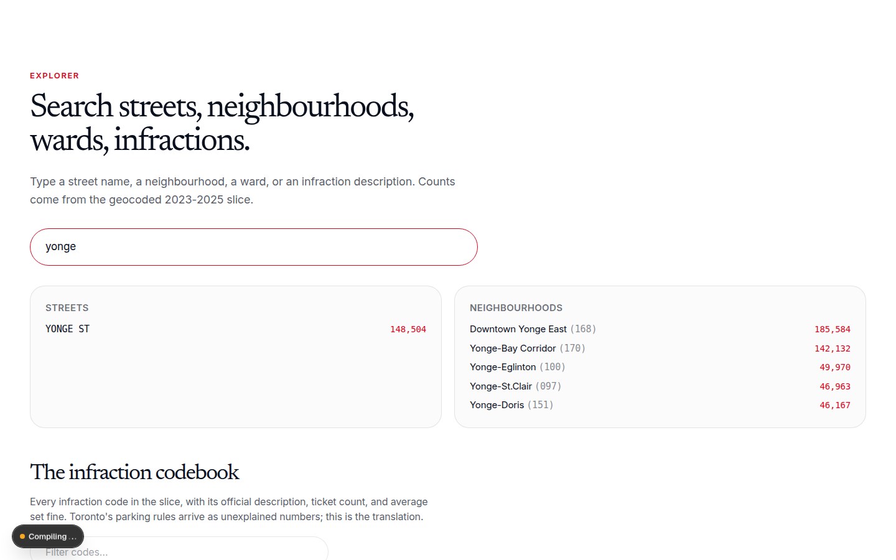

# toronto-parking-tickets-geocoded

Toronto parking tickets, calendar years 2023-2025, geocoded to wards and 158-model neighbourhoods. Nshipyard Canada project 06.

Toronto issues about 2.8 million parking tickets a year. The City of Toronto publishes every ticket through its open data portal: date, time, infraction code, set fine, and street address. This project answers the question the raw files cannot: what does that enforcement look like on a map. Each ticket address is matched to the City's Address Points (Municipal) file, which supplies the ward; the 158-model neighbourhood comes from a point-in-polygon join on official boundary geometries.

An open-source civic project. Not affiliated with the Government of Canada or the City of Toronto.

## Screenshots

## What the data shows

(Findings computed from the 2023-2025 slice; numbers below come from `data/summary.json`.)

- 6,454,695 tickets in the slice; 5,606,483 geocoded to a ward and neighbourhood, a match rate of 86.9%. 454,178 tickets carry no house number (street-only locations, intersections) and cannot be address-matched; 394,034 have an address the City's address file does not contain.
- The top infraction is not a street violation: code 3, "PARK ON PRIVATE PROPERTY", with 1,085,167 tickets (19.4% of geocoded tickets). Private lots, not curbs, are Toronto's most-ticketed parking.
- Ward 10 (Spadina-Fort York) absorbs 811,816 tickets, 14.5% of the geocoded total, led by code 207 (parking machine fee not paid). The Annex (095) is the most-ticketed neighbourhood at 244,764.
- Yonge St is the most-ticketed street at 148,504, followed by Keele St (118,435) and Queen St W (118,132).
- Enforcement peaks at 11h and in May; Sundays are the quietest day. Set fines on geocoded tickets total $377.7 million.

## Files

- `data/tickets_by_ward.csv` - per-ward ticket counts, fines, yearly splits, top infraction code
- `data/tickets_by_neighbourhood158.csv` - per-neighbourhood (158 model) ticket counts and fines
- `data/infraction_codebook.csv` - every infraction code with official description, count, average fine
- `data/top_streets.csv` - the 200 most-ticketed streets by normalized name
- `data/summary.json` - slice definition, match rate, totals, top findings
- `data/temporal.json` - tickets by hour, month, day of week
- `data/app_data.json` - compact bundle consumed by the app
- `data/raw/` - source downloads (not committed): yearly ticket ZIPs, Address Points CSV

## Methodology

Slice: City of Toronto open data "Parking Tickets", calendar years 2023-2025, retrieved 2026-10-08. Geocoding: ticket street addresses matched to Address Points (Municipal), Toronto One Address Repository, on house number plus normalized street name; ward from the address point, neighbourhood from point-in-polygon on 158-model boundaries. Tickets with no house number (street-only locations, intersections) cannot be address-matched and are counted as unmatched; the match rate is reported in `data/summary.json`. Limitations: tag numbers are masked, so no per-vehicle analysis; payment and dispute outcomes are not in the source; density reflects where officers write tickets, not only where violations occur.

## API

REST under `/api/v1/tickets/`: `summary`, `by_ward`, `by_neighbourhood`, `infractions`, `streets`, `search`. OpenAPI 3.1 at `/api/openapi.json`. MCP at `POST /mcp` with tools `tickets_ward_stats`, `tickets_neighbourhood_stats`, `tickets_infractions`.

## Author

**Richardson Dackam** - [X (@richardsondx)](https://x.com/richardsondx) · [GitHub](https://github.com/richardsondx)
